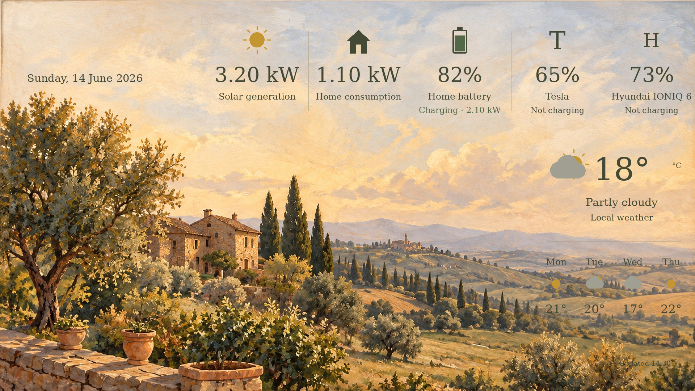

# Frame Energy Art

**Live home energy, painted into art for Samsung The Frame.**
A Home Assistant integration.

My Samsung The Frame shows a painting. The painting also shows my home:
solar power, home consumption, the home battery, two electric cars and the
weather. It still looks like art on the wall, not like a dashboard.

Created by **Ilja Dulushkov** ([@ediplomat](https://github.com/ediplomat)),
MEng Autonomous Robotics student at NMITE, Hereford.



Why I made it and what I learned: [The story behind the project](docs/STORY.md).

## The idea

- The painting is the main thing. Numbers sit in the sky, in the colours of
  the painting and a classic serif font.
- No boxes, panels or clock. A clock on a picture that updates every 15
  minutes would show the wrong time most of the time.
- Cars are shown as monograms, for example **T** and **H**, not brand logos.
- The integration works locally: the picture is drawn in Home Assistant and
  sent to the TV over your home network. Your sensors can still come from
  cloud integrations, for example cars or weather.

## What it does

Every update:

1. reads the current values from Home Assistant;
2. paints them onto the background picture (1920 × 1080 JPEG);
3. sends the picture to the TV and waits until the TV confirms it;
4. shows it if the TV is in Art Mode. If you are watching TV, it is only
   set as the current artwork and appears when you go back to Art Mode;
5. deletes only the previous picture made by this project.

Your own photos and artworks on the TV are never touched. If the TV does not
confirm the picture, the action fails and the status sensor says why.
Pictures that could not be deleted are remembered and tried again on the next
update (up to 5 per update). If the number keeps growing, the status sensor
shows it in `pending_deletes`.

## Status

Experimental. Tested with Home Assistant Green and a Samsung The Frame
43-inch (2019). Other Frame models and years are not tested yet; Samsung has
changed Art Mode on newer models.

## Plans

- Test a newer Samsung The Frame. I have a second, newer Frame at home.
- Try LG OLED Gallery TVs. **LG is not supported yet.** OLED can burn in from
  static pictures, so this needs more than a new picture every 15 minutes.
  Ideas, not tested yet: small shifts of the layout, changing backgrounds and
  a darker image.
- Make the update interval a setting, if people ask for it.

If you test it on another TV, please open an issue and tell me the model and
year, even if it works.

## Installation

### HACS (custom repository)

1. HACS → three dots → **Custom repositories**.
2. Add `https://github.com/ediplomat/Home-Assistant-Frame-Energy-Art`,
   type **Integration**.
3. Install **Frame Energy Art** and restart Home Assistant.

### Manual

Copy `custom_components/frame_energy` to `/config/custom_components/` and
restart Home Assistant.

### Background picture

HACS installs only the integration, not the picture. Do this once:

1. Download
   [tuscan_background.jpg](https://github.com/ediplomat/Home-Assistant-Frame-Energy-Art/raw/main/assets/tuscan_background.jpg)
   from this repository, or use your own picture (1920 × 1080 or larger).
2. In Home Assistant open the `media` folder, for example with the
   **File editor** or **Samba share** add-on.
3. Create the folder `frame_assets` and put the picture there, so the path is
   `/media/frame_assets/tuscan_background.jpg`.

You can use another path; then enter it in the setup.

## Setup

1. **Settings → Devices & services → Add integration → Frame Energy Art.**
2. Choose your sensors, the names shown in the picture and the TV's IP address.
   Give the TV a fixed IP address in your router.
3. Turn the TV on and press **Submit**. If the TV asks, choose **Allow**.
   Some models, like my 2019 Frame, connect without asking.
4. Run **Frame Energy Art: Paint and show** (`frame_energy.render`) from
   Developer tools → Actions and look at the TV.

Everything can be changed later with **Configure** on the integration.

| Field | Example | Expected value |
| --- | --- | --- |
| Solar | `sensor.solar_power` | W or kW |
| Home | `sensor.home_power` | W or kW |
| Battery | `sensor.home_battery_percentage` | 0–100% |
| Battery charge | `sensor.battery_charging_power` | W or kW, positive |
| Battery discharge | `sensor.battery_discharging_power` | W or kW, positive |
| First car | `sensor.tesla_battery_level` | 0–100% |
| First car power | `sensor.tesla_charging_power` | W or kW |
| Second car | `sensor.hyundai_battery_level` | 0–100% |
| Second car power | `sensor.hyundai_charging_power` | W or kW |
| Weather | `weather.home` | weather entity with daily forecast |
| Car names and monograms | `Tesla`, `T` | any text, 1–2 letters |
| Text under the weather | `Local weather` | for example your village |

**One car or no car:** leave the second car's sensors empty and its column is
not drawn; the rest of the row is centred. Leave both empty if you have no
electric car.

Missing or wrong values show a dash instead of breaking the picture. Values
are shown as Home Assistant has them; the integration does not check how
fresh they are.

## Automatic updates

After a successful manual test, add
[examples/automation.yaml](examples/automation.yaml) in the automation YAML
editor. It updates the picture every 15 minutes and one minute after Home
Assistant starts. Nothing is scheduled automatically.

## Status sensor

`sensor.frame_energy_last_generated` shows when the picture was last painted.
Attributes:

- `last_upload_confirmed` – when the TV last confirmed a picture;
- `content_id` – the current Art Mode artwork from this project (while you
  watch TV it waits for Art Mode);
- `pending_deletes` – old pictures still waiting to be deleted;
- `error` – the last problem, if any.

## Troubleshooting

- **No Frame Energy Art in Add integration:** check the folder name and
  restart Home Assistant.
- **Pairing fails:** check the IP address and that the TV is on. If the TV
  asks, press **Allow** within 30 seconds.
- **Missing background:** check the path and that the file exists.
- **Dashes instead of numbers:** check entity IDs, availability and units.
- **No forecast:** the weather entity must support daily forecasts.

## Development

The picture is drawn with Pillow in Home Assistant's executor, and the file is
replaced in one step, so the TV never gets a half-written picture. A lock stops
two updates running at the same time. The TV client (`tv.py`) talks to the
Frame's Art Mode over a local WebSocket.

```sh
python -m pip install 'Pillow>=10.0.0'
python -m unittest discover -s tests
```

The tests use a fake TV, so they do not need a real television.

## Support

Shared as is, from one home setup. Issues and pull requests are welcome, but
there is no promise of support or of compatibility with other TV models.

## Licence and assets

Code and documentation: MIT, see [LICENSE](LICENSE).
The bundled DejaVu Serif font keeps its own notices in
[FONT_LICENSE.txt](FONT_LICENSE.txt). The Tuscan background is a generated
illustration supplied as a sample; you can use any picture you have the right
to use. Samsung, Tesla, Hyundai and Home Assistant names belong to their
owners. This project is not affiliated with them.
